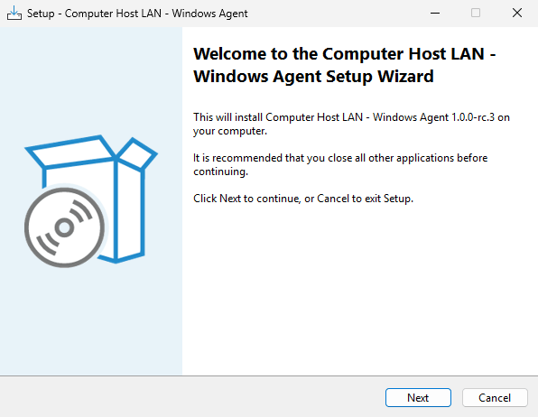
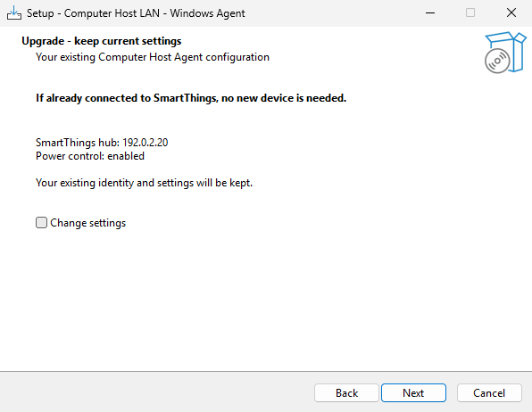
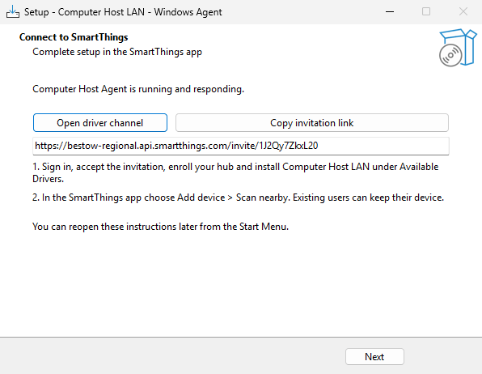

# Install on Windows

Use the instructions matching the version of the package you downloaded.

## 1. Prepare and download

Use Windows 11 x64 and a SmartThings hub on the same trusted private LAN. Download `computer-host-lan-v1.0.0-rc.3-windows-x64-unsigned-setup.exe` and SHA256SUMS.txt from the [v1.0.0-rc.3 release](https://github.com/ldeora/SmartThingsEdgeDrivers/releases/tag/computer-host-lan-v1.0.0-rc.3). Do not substitute ordinary CI artifacts. In PowerShell in the download directory:

```powershell
Get-FileHash -Algorithm SHA256 -LiteralPath '.\computer-host-lan-v1.0.0-rc.3-windows-x64-unsigned-setup.exe'
```

Compare the full hash with the corresponding manifest entry. Stop on mismatch. Windows packages are unsigned; unknown publisher, SmartScreen and Smart App Control may warn or block. A matching checksum is not publisher authentication or a code signature. Do not disable protections to run an untrusted file.

## 2. Run Setup

Run the verified Setup as administrator.



**Upgrading?** Run Setup directly over the previous Setup or ZIP installation; do not uninstall or purge state first. An existing installation shows a keep-current-settings summary when its hub/firewall scope and power preference are valid. Click Next to keep them; choose Change settings only when needed. Missing or ambiguous scope requires an explicit selection. See [upgrade](upgrade.md).



**SmartThings hub.** Confirm the discovered hub, use Search again, or type its IP address; the status line then shows the address Setup will use. Give the hub a fixed IP address in your router. Prefer the hub-only Private firewall rule; choose the local-network option under Advanced options only if necessary.

**Power management.** Leave "Allow SmartThings to shut down, restart and put this PC to sleep" off for first-time monitoring. To switch the PC on from SmartThings, enable Wake-on-LAN in the network adapter's properties and in the BIOS/UEFI; Setup does not change these settings.

## 3. Connect to SmartThings

Follow [SmartThings setup](smartthings.md#add-a-computer). Refresh an existing device instead of pairing again.

After a new installation, Setup shows the same steps and the invitation link:



If you allowed power control, the next page shows the power control key; keep it private.

## 4. Check operation

Verify CPU, RAM, disk, uptime and host status. Windows ARM64 packages are cross-built but not physically qualified; this guide is for x64. If a valid retained key was kept, no new key setup is needed. If monitoring is not working, check [troubleshooting](troubleshooting.md). Optional remote power requires host opt-in, Enable shutdown/reboot/suspend and the matching private 64-hex Power control key in device settings. Save work and keep physical access before testing. Sleep and Wake-on-LAN depend on hardware.

See [upgrade and recovery](upgrade.md).

## 5. Maintenance and network changes

Use Windows Installed apps for normal removal (identity/key retained). To
update the hub IP, use the matching package's Set-WindowsHubAddress.ps1 as described in [PowerShell fallback](#powershell-fallback). For an abandoned upgrade
snapshot use Setup's recovery or the matching ZIP's documented restore
script. See [maintenance journeys](upgrade.md) before a reinstall or fresh start.

## 6. Frequently asked questions

### What does Setup install, and where can I see it?

- **Program files** in `C:\Program Files\Computer Host Agent`: the agent with its own .NET runtime (nothing else to install), its settings file `appsettings.json`, a `Docs` folder (connection guide, licence, third-party notices) and an `Installer` folder with maintenance scripts.
- **A Windows service**, "Computer Host Agent (monitoring)" (`ComputerHostAgent`). It runs as the limited LocalService account and starts with Windows. See `services.msc`.
- **A firewall rule**, "Computer Host Agent (trusted LAN)": incoming TCP 8765 by default (or your configured port), Private networks only, limited to your hub (or the local network if you chose that option). See Windows Defender Firewall → Advanced settings → Inbound Rules.
- **The installation identity and key** in `C:\ProgramData\ComputerHostAgent`.
- **A Start menu entry**, Computer Host LAN → Connect to SmartThings, and **an entry in Settings → Apps → Installed apps**: "Computer Host LAN - Windows Agent".

Setup installs no drivers, scheduled tasks or browser components. Its hub search runs from a temporary folder and is not kept.

### How do I uninstall it?

Settings → Apps → Installed apps → "Computer Host LAN - Windows Agent" → Uninstall. This removes the service, program files, firewall rule and Start menu entry.

`C:\ProgramData\ComputerHostAgent` stays on purpose, so a later reinstall continues as the same SmartThings device. For deliberate permanent removal of identity and credentials, follow [start completely fresh or retire a computer](upgrade.md#start-completely-fresh). Removing the driver from the hub is optional and affects other computers using it.

### Is Setup available in German?

Not yet. The device capabilities include German translations; Setup itself is English. A German Setup is planned after the stable release ([#210](https://github.com/ldeora/SmartThingsEdgeDrivers/issues/210)).

### Why does the uptime show several days although I shut the PC down?

See [Windows uptime and Fast Startup](troubleshooting.md#uptime-looks-too-long-windows).

## PowerShell fallback

Prefer graphical Setup on Windows x64. If it cannot be used, download the
matching Windows ZIP from the [release](https://github.com/ldeora/SmartThingsEdgeDrivers/releases/tag/computer-host-lan-v1.0.0-rc.3), verify the ZIP checksum,
extract it and open Windows PowerShell as Administrator in its directory:

```powershell
$hubIPv4 = '192.168.1.20' # Replace with your hub's IPv4
.\scripts\Verify-Package.ps1
.\scripts\Install-WindowsAgent.ps1 -WhatIf -HubIPv4 $hubIPv4
.\scripts\Install-WindowsAgent.ps1 -HubIPv4 $hubIPv4
Get-Service ComputerHostAgent
Invoke-RestMethod http://127.0.0.1:8765/v2/health
```

On fresh installation use the actual hub IPv4, or explicitly select
`-LocalSubnet` instead (Private networks only). On upgrade, omit scope
and power flags to retain valid previous settings; if scope is missing or
ambiguous, explicitly select a valid replacement. To change power use
`-EnablePower` or `-DisablePower`. Do not combine opposing choices.
Use the actual configured HTTP port if different. Do not disable platform
security controls. If a script is blocked, consult the administrator and
the trusted package's documented verification procedure.

After installation, follow [SmartThings setup](smartthings.md). If power
was enabled, retrieve the existing key privately from an elevated prompt:
`Get-Content "$env:ProgramData\ComputerHostAgent\control-token"`.
For script-based removal use `.\scripts\Uninstall-WindowsAgent.ps1`
(without `-PurgeState`). See [maintenance](upgrade.md) for recovery or a
deliberate fresh start.

To change a hub-scoped firewall address without reinstalling, run the
installed maintenance script from elevated PowerShell, replacing the IP:

```powershell
& "$env:ProgramFiles\Computer Host Agent\Installer\Set-WindowsHubAddress.ps1" -HubIPv4 192.168.1.20
```

See [firewall troubleshooting](troubleshooting.md#firewall-and-avahi).
