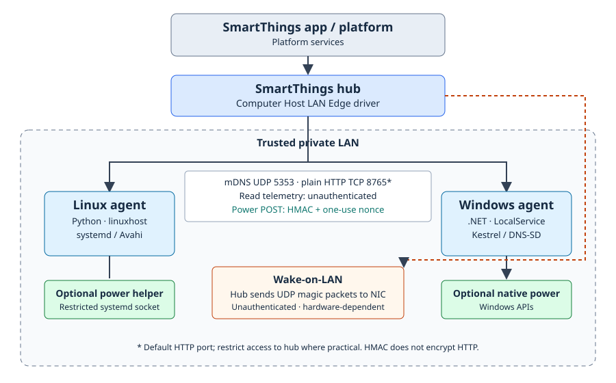

# Architecture

Computer Host LAN has one SmartThings Edge driver and separate native
agents for Linux and Windows, sharing the [protocol v2 contract](protocol.md).
The host runs no separate cloud broker. The SmartThings app and platform
are outside the agent's trust boundary.

## Components and responsibilities

| Component | Responsibility |
| --- | --- |
| `edge-driver/src/init.lua` | Device lifecycle, health/telemetry timers, command acknowledgements and state reconciliation |
| `computerhost/discovery.lua`, `util.lua` | DNS-SD candidates, verified UUID association, endpoint/WOL metadata and preference validation |
| `computerhost/api.lua`, `sha256.lua` | Bounded local HTTP and HMAC; no automatic retry of power POSTs |
| `computerhost/state.lua`, `presence.lua` | Pure state transition and failure classification |
| `computerhost/power.lua`, `wol.lua` | Challenge/command path and UDP magic packet transmission |
| `computerhost/telemetry.lua` | Validated metrics, capability emission/cache and optional fields |
| Linux agent | Python 3.10+ standard-library HTTP, systemd service as linuxhost, Avahi, procfs/sysfs/statvfs |
| Linux power helper | Restricted systemd Unix socket, peer UID validation, fixed systemctl operations |
| Windows agent | C#/.NET 10 self-contained Kestrel Windows Service as LocalService, native DNS-SD registration, Windows telemetry and power APIs |
| Installers | Versioned Linux standalone protected engine and Windows Setup/PowerShell service maintenance; preserve identity and credentials |

The Windows agent uses GetSystemTimes for CPU, GlobalMemoryStatusEx for
RAM, the system drive for disk and GetTickCount64 for uptime. Its protected
boot-session identity is heuristic, not an electrical sensor. Fast Startup
can preserve kernel uptime. Linux reads the kernel boot ID. Both advertise
power only when configured and available; neither fabricates missing
measurements. The protocol is separate from application versioning.

## Discovery and identity

DNS-SD advertises _computerhost._tcp.local; info validation creates a device
network ID of computer-host:<lowercase UUID>. A matching known responsive
endpoint wins over a competing candidate; after failure, a matching new
endpoint may be selected but must pass normal health confirmation before
power POSTs or WOL metadata refresh. Keep cached WOL data until then.
An explicit static host override blocks automatic endpoint replacement.
Wrong UUID/protocol/platform data must not supply measurements or power
routing. UUID validation is not authentication. Windows asynchronous DNS-SD
registration failure is retried with backoff; pending registration is not
success. Never assume a host's DHCP address is its identity.

The Linux and Windows profiles retain the same device/component identifiers
and shared custom capability IDs; the basic profile is the fallback.
Linux adds temperature and load averages. Embedded advanced profile
deviceConfig supplies the Host Status tile and switch action, plus complete
detail and automation lists. Account-level custom capability changes are
separate. See [settings and routine guidance](../smartthings.md).

## State and power transitions

Health polling defaults to 20 seconds, telemetry to 60; pending actions
poll faster (5 seconds). Failed polls are classified before inference.
Threshold defaults to three; a connection refusal indicates the agent
is unavailable, while host timeouts can infer off only when configured.
Unknown protocol/identity/transport errors never prove physical off.
Successful polls reconcile the switch and Host Status; metrics failures
must not masquerade as power completion.

| Trigger | Immediate acknowledgement | Completion evidence / fallback |
| --- | --- | --- |
| Switch Off, accepted shutdown | Off + Stopping | Repeated host-unreachable evidence → inferred Stopped; responsive agent after 60 s → Running/On; new boot ID clears stale shutdown |
| Switch On, successful WOL transmission | On + Starting | Matching health → Running; timeout reconciles with observed/inferred state |
| Restart accepted | Rebooting | Changed boot ID, not merely a connectivity gap |
| Sleep accepted | Suspending | Repeated host-unreachable evidence → inferred Suspended; two failed polls then success can confirm resume; continuously responding agent may return Running after 30 s |
| Unknown/failed command | No optimistic successful acknowledgement | Reassert appropriate known switch state; never blindly repeat a signed request |

Pending actions expire after 180 seconds; settled Stopped/Suspended may
survive continued host silence. During shutdown grace, duplicate OFF and
conflicting actions cannot overwrite the pending action. Momentary Wake
sends a packet but is not physical confirmation. Read
[Host Status](../smartthings.md#host-status-and-the-switch) for user semantics.

HTTP 202 has platform-specific meaning: Linux shutdown/reboot helper accepts
a delayed attempt (one second before invoking systemctl); suspend waits for
systemctl invocation success. The Windows native shutdown/reboot API must
accept the request before 202; it does not force application closures.
Suspend queues a delayed attempt, not proven sleep. Immediate refusal and
later failure differ. WOL is independent of host power opt-in and depends on
NIC/firmware/network/OS; no transport can prove the power state electrically.

## Windows maintenance contract

| Installation path | New/reinstall | Upgrade without changes | Explicit change |
| --- | --- | --- | --- |
| GUI | Power off; choose valid hub IPv4 or Private LocalSubnet | Keep validated power and scope; summary first | Change settings, confirm choice |
| Silent Setup | Explicit /HUBIP or /LOCALSUBNET=1 | Keep valid settings | /ENABLEPOWER=1 or 0 and/or explicit scope |
| PowerShell ZIP | -HubIPv4 or -LocalSubnet; power off | Keep valid settings | -EnablePower or -DisablePower, explicit scope |

Reinstall without a registered service requires a fresh scope selection even
when retained identity is valid. Invalid/conflicting explicit flags refuse;
missing/ambiguous scope must not broaden to LocalSubnet. Existing power
configuration must be a boolean (absent legacy field means off, malformed
configuration refuses). Keep custom port and unrelated settings.
Prior firewall rule must be one enabled Private inbound TCP allow rule for
the agent executable and canonical unicast IPv4 or LocalSubnet. Recreate
only the project-owned rule. -SkipFirewall is an explicit advanced/test
option, not a GUI fallback.

The service installation validates ownership and retained ACLs before
mutation. Upgrade snapshots capture managed app/config/service/firewall
state; verify runtime version, identity and health before committing.
Recovery validates the abandoned snapshot; after restoring, restart Setup
to re-inspect instead of reusing stale choices. Normal removal retains
ProgramData. Unsafe identity refuses startup; unsafe/missing key disables
power while otherwise safe monitoring continues. Do not silently regenerate
credentials. GUI key-page omission requires confirmed prior opt-in and
retained key (or power disabled), not merely a guessed upgrade.

See [security and privacy](../../SECURITY.md), [maintenance](../upgrade.md)
and [Linux installer reference](linux-installer.md). Native Windows CI
and source fixtures cannot establish physical sleep, WOL or hub behavior.
