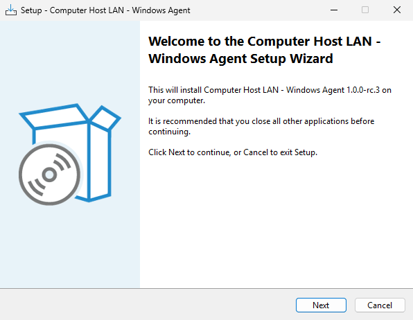
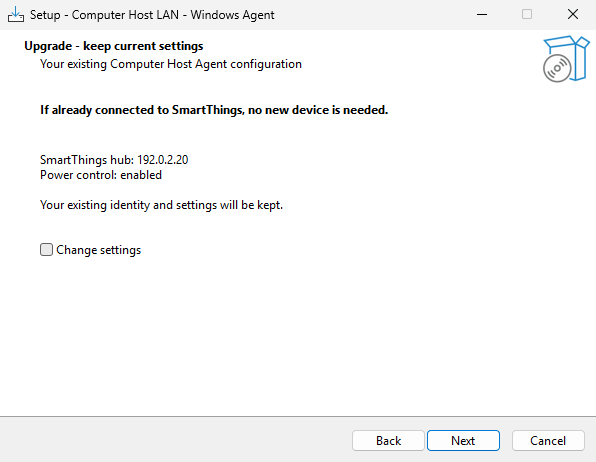
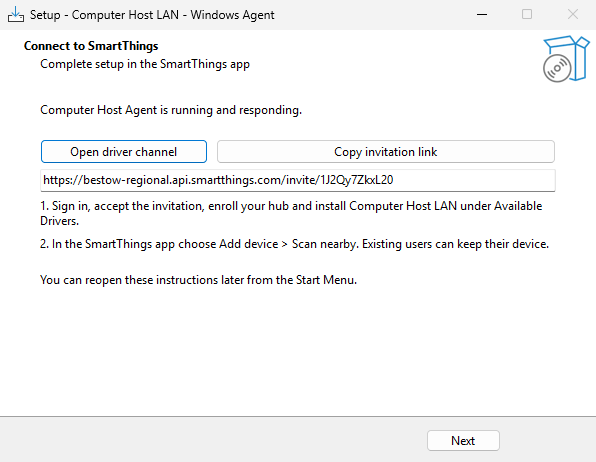

# Windows quick start — v1.0.0-rc.3

This guide is for v1.0.0-rc.3.

## 1. Prepare and download

Use Windows 11 x64 and a SmartThings hub on the same trusted private LAN. Download `computer-host-lan-v1.0.0-rc.3-windows-x64-unsigned-setup.exe` and SHA256SUMS.txt from the [v1.0.0-rc.3 release](https://github.com/ldeora/SmartThingsEdgeDrivers/releases/tag/computer-host-lan-v1.0.0-rc.3). Do not substitute ordinary CI artifacts. In PowerShell in the download directory:

```powershell
Get-FileHash -Algorithm SHA256 -LiteralPath '.\computer-host-lan-v1.0.0-rc.3-windows-x64-unsigned-setup.exe'
```

Compare the full hash with the corresponding manifest entry. Stop on mismatch. Windows packages are unsigned; unknown publisher, SmartScreen and Smart App Control may warn or block. A matching checksum is not publisher authentication or a code signature. Do not disable protections to run an untrusted file.

## 2. Run Setup

Run the verified Setup as administrator.



**Upgrading?** Run Setup directly over the previous Setup or ZIP installation; do not uninstall or purge state first. An existing installation shows a keep-current-settings summary when its hub/firewall scope and power preference are valid. Click Next to keep them; choose Change settings only when needed. Missing or ambiguous scope requires an explicit selection. See [upgrade](https://github.com/ldeora/SmartThingsEdgeDrivers/blob/computer-host-lan-v1.0.0-rc.3/computer-host-lan/docs/release/UPGRADE.md).



**SmartThings hub.** Confirm the discovered hub, use Search again, or type its IP address; the status line then shows the address Setup will use. Give the hub a fixed IP address in your router. Prefer the hub-only Private firewall rule; choose the local-network option under Advanced options only if necessary.

**Power management.** Leave "Allow SmartThings to shut down, restart and put this PC to sleep" off for first-time monitoring. To switch the PC on from SmartThings, enable Wake-on-LAN in the network adapter's properties and in the BIOS/UEFI; Setup does not change these settings.

## 3. Connect to SmartThings

Open the [driver invitation](https://bestow-regional.api.smartthings.com/invite/1J2Qy7ZkxL20), enroll your hub if necessary, install Computer Host LAN, then Add device → Scan nearby for a new computer. Existing device? Refresh it; do not re-pair.

After a new installation, Setup shows the same steps and the invitation link:



If you allowed power control, the next page shows the power control key; keep it private.

## 4. Check operation

Verify CPU, RAM, disk, uptime and host status. Windows ARM64 packages are cross-built but not physically qualified; this guide is for x64. If a valid retained key was kept, no new key setup is needed. If monitoring is not working, check [troubleshooting](https://github.com/ldeora/SmartThingsEdgeDrivers/blob/computer-host-lan-v1.0.0-rc.3/computer-host-lan/docs/release/TROUBLESHOOTING.md). Optional remote power requires host opt-in, Enable shutdown/reboot/suspend and the matching private 64-hex Power control key in device settings. Save work and keep physical access before testing. Sleep and Wake-on-LAN depend on hardware.

[Detailed instructions and recovery](https://github.com/ldeora/SmartThingsEdgeDrivers/blob/computer-host-lan-v1.0.0-rc.3/computer-host-lan/INSTALLATION.md).

## 5. Maintenance and network changes

Use Windows Installed apps for normal removal (identity/key retained). To
update the hub IP, use the matching package's Set-WindowsHubAddress.ps1 as
documented in [installation](https://github.com/ldeora/SmartThingsEdgeDrivers/blob/computer-host-lan-v1.0.0-rc.3/computer-host-lan/INSTALLATION.md). For an abandoned upgrade
snapshot use Setup's recovery or the matching ZIP's documented restore
script. See [maintenance journeys](https://github.com/ldeora/SmartThingsEdgeDrivers/blob/computer-host-lan-v1.0.0-rc.3/computer-host-lan/docs/release/UPGRADE.md) before a reinstall or fresh start.
